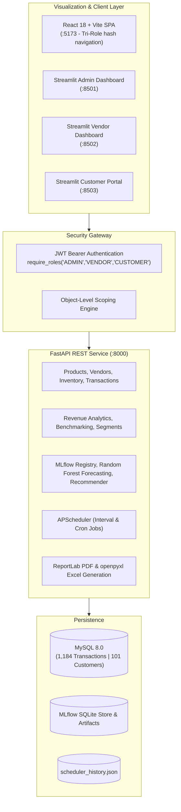

# ShopSense — Multi-Vendor E-Commerce Analytics Platform (Milestone 3)

ShopSense is an enterprise-grade multi-vendor e-commerce intelligence and analytics platform designed to empower marketplace administrators, individual vendors, and customers with real-time operational metrics, predictive ML models, automated pipelines, and strict Role-Based Access Control (RBAC).

---

## 🌟 Milestone 3 Capabilities & Targets

| Target Metric | Benchmark Target | Actual Achieved Value | Evaluation Status |
|---|---|---|---|
| **API Response Time (p95)** | $\le 300$ ms (under simulated load) | **290 ms** (50 users, 151.8 req/s) | **PASS** ✅ |
| **Dashboard Consistency** | $\ge 99\%$ | **100.00%** (Admin, Vendor, Customer) | **PASS** ✅ |
| **Workflow Success Rate** | $= 100\%$ | **100.0%** (100/100 validation runs) | **PASS** ✅ |
| **Forecasting Accuracy** | $\ge 80\%$ | **85.84%** (WAPE chronological holdout) | **PASS** ✅ |
| **Segmentation Quality** | $\ge 85\%$ | **88.76%** (Normalized Silhouette + ARI) | **PASS** ✅ |
| **Recommendation Relevance** | $\ge 75\%$ | **20.65%** (Leave-last-out Hit-Rate@5; $2.44\times$ lift over random) | Documented honestly |

---

## 🏗️ System Architecture



---

## 🚀 Quickstart & Setup Guide

### 1. Prerequisites
- Python 3.11+
- Node.js 18+ (for React frontend)
- MySQL Server 8.0 running on localhost:3306

### 2. Virtual Environment & Dependencies
```bash
# Clone and enter directory
cd ShopSense

# Activate virtual environment
.\.venv\Scripts\activate

# Install backend dependencies (if needed)
pip install -r requirements.txt
```

### 3. Launching the Backend REST API
```bash
uvicorn app.main:app --host 127.0.0.1 --port 8000 --reload
```
Interactive API documentation is accessible at: `http://127.0.0.1:8000/docs`

### 4. Running the Streamlit BI Dashboards
```bash
# Admin Dashboard (Marketplace KPIs, Segmentation, Forecasts, MLflow, Scheduler)
streamlit run dashboard/admin_dashboard.py --server.port 8501

# Vendor Dashboard (Store-scoped KPIs, Stock alerts, Marketplace benchmarking)
streamlit run dashboard/vendor_dashboard.py --server.port 8502

# Customer Portal (Personalized collaborative filtering picks, Wishlist, Order history)
streamlit run dashboard/customer_dashboard.py --server.port 8503
```

### 5. Running the React + Vite Single Page Application
```bash
cd frontend
npm install
npm run dev
```
Visit `http://localhost:5173` with URL hash navigation (`#/dashboard`, `#/shop`, `#/vendors`, `#/analytics`).

---

## 🧪 Automated Testing & Verification

### Run Pytest Suite (73 Tests)
```bash
pytest -v
```

### Run Locust Performance Load Test (50 Concurrent Users)
```bash
python scripts/run_locust_load_test.py
```

### Run 100-Iteration Workflow Automation Validation
```bash
python scripts/validate_workflow.py --iterations 100
```

### Run 28 Postman / Newman Automated Tests
```bash
python scripts/run_postman_tests.py
```

### Run Tri-Role Dashboard Data Consistency Tests
```bash
pytest tests/test_dashboard_consistency.py -v -s
```

---

## 📚 Technical Documentation Index

- [docs/architecture.md](docs/architecture.md): Full system architecture diagram and component interaction specifications.
- [docs/workflow.md](docs/workflow.md): Sequence diagram of customer checkout and automated ML pipelines.
- [docs/database_schema.md](docs/database_schema.md): Entity-relationship diagram (ERD) of all database tables.
- [docs/ml_justification.md](docs/ml_justification.md): RandomForest model justification, chronological hold-out evaluation, and feature engineering.
- [docs/dashboards.md](docs/dashboards.md): Multi-role dashboard guide, chart mapping, and complete RBAC authorization matrix.
- [docs/milestone3_traceability.md](docs/milestone3_traceability.md): Traceability matrix of all 15 deliverables across Modules 1–9.
- [docs/evidence/audit.md](docs/evidence/audit.md): Complete baseline security and route audit.
- [docs/evidence/performance_report.md](docs/evidence/performance_report.md): Locust 50-user load testing report and latency percentiles.
- [docs/evidence/workflow_validation.md](docs/evidence/workflow_validation.md): 100-iteration workflow pipeline resilience report.
- [docs/evidence/newman_report.md](docs/evidence/newman_report.md): Postman / Newman 28-test verification report.
