# ShopSense Milestone 3 — System Architecture

## 1. High-Level Architecture Overview

ShopSense is an enterprise-grade multi-vendor e-commerce analytics platform engineered with **FastAPI**, **MySQL (InnoDB)**, **MLflow Model Registry**, **APScheduler Workflow Engine**, **React/Vite SPA**, and **Streamlit BI Dashboards**.

```mermaid
flowchart TD
    subgraph Client_Layer ["Client & Visualization Layer"]
        ReactUI["React + Vite Single Page App\n(Port 5173 - Tri-Role)"]
        StreamlitAdmin["Streamlit Admin Dashboard\n(Port 8501)"]
        StreamlitVendor["Streamlit Vendor Dashboard\n(Port 8502)"]
        StreamlitCust["Streamlit Customer Portal\n(Port 8503)"]
    end

    subgraph Security_Gateway ["Security & RBAC Enforcement"]
        JWTAuth["JWT Bearer Authentication\n(OAuth2 Token Verified)"]
        RBAC["Role-Based Access Control Gatekeeper\n(require_roles: ADMIN, VENDOR, CUSTOMER)"]
        ObjectScoping["Object-Level Scoping Engine\n(Vendor own data, Customer own profile)"]
    end

    subgraph API_Layer ["FastAPI Application Backend (Port 8000)"]
        AuthRouter["/api/auth (Login / Register)"]
        CatalogRouter["/api/products & /api/vendors"]
        InventoryRouter["/api/inventory (Turnover & Shortage)"]
        AnalyticsRouter["/api/analytics (Revenue & Benchmarking)"]
        MLRouter["/api/forecast & /api/recommend"]
        ReportsRouter["/api/reports (PDF & Excel Exports)"]
        SchedulerRouter["/api/scheduler (Job Status & Triggers)"]
        WishlistRouter["/api/wishlist (Customer Wishlists)"]
    end

    subgraph ML_Analytics ["Machine Learning & Automated Pipelines"]
        MLflow["MLflow 3.18 Tracking & Registry\n(RandomForest 'InventoryForecast')"]
        APScheduler["APScheduler Background Service\n(Every 2h, Daily 02:00 Cron, 30m Analytics)"]
        Recommender["Item-Based Collaborative Filtering\n(Cosine Similarity + Popularity Fallback)"]
        Segmentation["K-Means RFM Segmentation (K=4)\n(High Spenders, Frequent Buyers, etc.)"]
    end

    subgraph Storage_Layer ["Data Persistence Layer"]
        MySQL[("MySQL 8.0 RDBMS\n(1,184 Transactions | 101 Customers)")]
        SQLite[("MLflow SQLite Store\n(Runs, Metrics, Artifacts)")]
        DiskHistory[("JSON Audit State\nscheduler_history.json")]
    end

    Client_Layer --> Security_Gateway
    Security_Gateway --> API_Layer
    API_Layer --> ML_Analytics
    API_Layer --> Storage_Layer
    ML_Analytics --> Storage_Layer
```

---

## 2. Component Design & Roles

| Component | Technology | Role & Responsibilities |
|---|---|---|
| **Backend API** | FastAPI, Starlette, Uvicorn | High-performance asynchronous REST API with automatic OpenAPI documentation (`/docs`) and dependency injection. |
| **Security Layer** | Python-JOSE, Passlib (Bcrypt) | Cryptographically signed JWT tokens with claims (`sub`, `email`, `role`). Strict RBAC enforcement via `require_roles()`. |
| **Database** | MySQL 8.0, SQLAlchemy 2.0 | Relational database handling transactions, vendors, products, inventory, customer insight profiles, and wishlists. |
| **ML Lifecycle** | MLflow 3.18 | End-to-end model tracking: logging hyperparameters (`n_estimators=100`), evaluation metrics (`Accuracy`, `MAE`, `RMSE`), model artifact logging (`InventoryModel`), and version registration in Model Registry (`InventoryForecast`). |
| **Automation** | APScheduler | Background scheduler running cron and interval jobs for automated model retraining, analytics consolidation, and resilience recovery. |
| **BI Dashboards** | Streamlit, Plotly Express | Multi-role interactive dashboards consuming FastAPI endpoints with live charts, filtering, and PDF/Excel downloads. |
| **Frontend SPA** | React 18, Vite, Tailwind CSS | Single-page e-commerce app with client-side RBAC hash routing, dynamic navigation menus, and cart/checkout workflows. |
