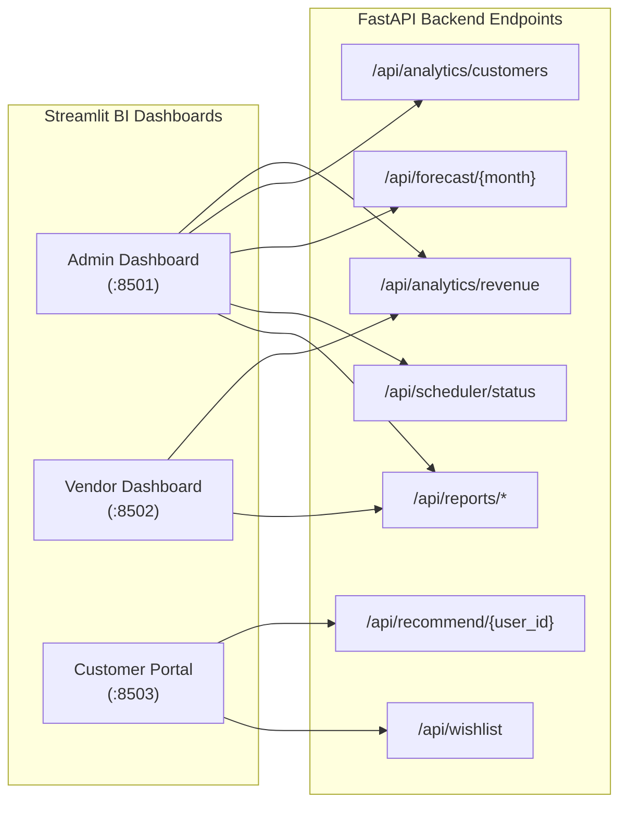

# ShopSense Milestone 3 — Dashboard Guide & RBAC Authorization Matrix

## 1. Dashboard Portals & Specifications

ShopSense provides three specialized dashboards tailored to each stakeholder role:

---

## 2. Role-Based Access Control (RBAC) Matrix

| Endpoint | HTTP Method | Anonymous | CUSTOMER | VENDOR | ADMIN | Scope & Enforced Behavior |
|---|---|---|---|---|---|---|
| `/api/auth/login` | `POST` | ✅ 200 | ✅ 200 | ✅ 200 | ✅ 200 | Issues signed JWT with role claim. |
| `/api/auth/register` | `POST` | ✅ 201 | ❌ 422 | ❌ 422 | ❌ 422 | New user signup. |
| `/api/products` | `GET` | ❌ 401 | ✅ 200 | ✅ 200 | ✅ 200 | Public / active catalog items. |
| `/api/vendors` | `GET` | ❌ 401 | 🚫 **403** | ✅ 200 | ✅ 200 | **Fixed Known Bug:** Customers denied access. |
| `/api/vendors/{id}` | `GET` | ❌ 401 | 🚫 **403** | ✅ 200 | ✅ 200 | Vendor details directory. |
| `/api/inventory` | `GET` | ❌ 401 | 🚫 403 | ✅ 200 | ✅ 200 | Stock levels and warehouse locations. |
| `/api/transactions` | `GET` | ❌ 401 | ✅ 200 (Own) | ✅ 200 (Own shop) | ✅ 200 (All) | Scoped strictly to authenticated token ID. |
| `/api/analytics/revenue` | `GET` | ❌ 401 | 🚫 403 | ✅ 200 (Scoped) | ✅ 200 (Global) | GMV, AOV, MoM growth, vendor rankings. |
| `/api/analytics/customers` | `GET` | ❌ 401 | 🚫 403 | 🚫 403 | ✅ 200 | RFM customer segmentation and quality. |
| `/api/analytics/vendor-performance` | `GET` | ❌ 401 | 🚫 403 | 🚫 403 | ✅ 200 | Leaderboard ranking and metrics. |
| `/api/recommend/{user_id}` | `GET` | ❌ 401 | ✅ 200 (Own) | 🚫 403 | ✅ 200 (Any) | Object-level: customer cannot view other user IDs. |
| `/api/wishlist` | `GET/POST/DEL`| ❌ 401 | ✅ 200 | 🚫 403 | ✅ 200 | Customer-managed wishlist items. |
| `/api/scheduler/status` | `GET` | ❌ 401 | 🚫 403 | 🚫 403 | ✅ 200 | Pipeline health, timeline, and policies. |
| `/api/analytics/mlflow-status` | `GET` | ❌ 401 | 🚫 403 | 🚫 403 | ✅ 200 | Active runs and registered model versions. |
| `/api/reports/revenue` | `GET` | ❌ 401 | 🚫 403 | 🚫 403 | ✅ 200 | Global revenue PDF and Excel export. |
| `/api/reports/products` | `GET` | ❌ 401 | 🚫 403 | ✅ 200 (Scoped) | ✅ 200 (All) | Product and stock PDF/Excel export. |

---

## 3. Dashboard Features & Layout

### Admin Dashboard (`dashboard/admin_dashboard.py`)
- **KPI Row:** Total Revenue (GMV), Orders, AOV, Units Sold, Gross Profit (assumed 70% COGS), Active Customers, Forecast Accuracy.
- **Visualizations:**
  - Target vs Actual GMV (Plotly interactive gauge with red/yellow/green thresholds).
  - Monthly Revenue Trend & MoM Growth bar chart.
  - RFM Customer Segmentation pie chart ($K=4$).
  - Vendor Contribution horizontal bar chart.
  - Inventory Intelligence line chart (predicted daily units).
  - Scheduler Execution Timeline table with duration and status badges.
- **Reporting:** 1-click download buttons for ReportLab PDF and openpyxl Excel exports.

### Vendor Dashboard (`dashboard/vendor_dashboard.py`)
- **KPI Row:** Scoped Shop Revenue, Orders, Units Sold, Store AOV, Marketplace Share %.
- **Visualizations:** Store revenue trend, top selling store items, low-stock shortage alerts table.
- **Reporting:** Export scoped store inventory and products PDF/Excel.

### Customer Portal (`dashboard/customer_dashboard.py`)
- **KPI Row:** Lifetime Spend, Total Orders, Average Purchase Basket, RFM Tier Badge.
- **Personalized Recommendations:** Top 5 product cards powered by Collaborative Filtering + category affinity, with 1-click wishlist toggle.
- **Order History & Wishlist:** Real-time order logs and saved wishlist items.
