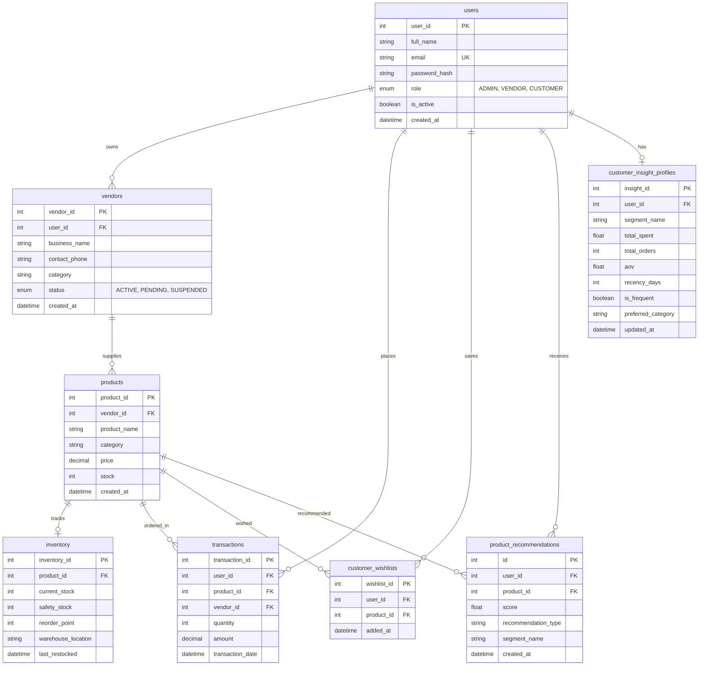

# ShopSense Milestone 3 — Database Schema & Entity Relationships

## 1. Entity-Relationship Diagram (ERD)

---

## 2. Table Specifications & Cardinalities

| Table Name | Primary Key | Key Foreign Keys | Purpose |
|---|---|---|---|
| `users` | `user_id` | — | Multi-role user accounts with hashed credentials and role claim. |
| `vendors` | `vendor_id` | `user_id` $\to$ `users.user_id` | Business profiles for marketplace sellers. |
| `products` | `product_id` | `vendor_id` $\to$ `vendors.vendor_id` | Product catalog with prices, stock levels, and categories. |
| `inventory` | `inventory_id` | `product_id` $\to$ `products.product_id` | Physical stock monitoring, reorder thresholds, and warehouse bins. |
| `transactions` | `transaction_id` | `user_id`, `product_id`, `vendor_id` | Historical purchase orders (1,184 records, ₹394,559.80 total). |
| `customer_wishlists` | `wishlist_id` | `user_id`, `product_id` | Customer-saved wishlist items with timestamp. |
| `product_recommendations` | `id` | `user_id`, `product_id` | Persisted personalized product recommendations and segment rankings. |
| `customer_insight_profiles` | `insight_id` | `user_id` $\to$ `users.user_id` | Persisted RFM scores, segment names, and frequency flags. |
