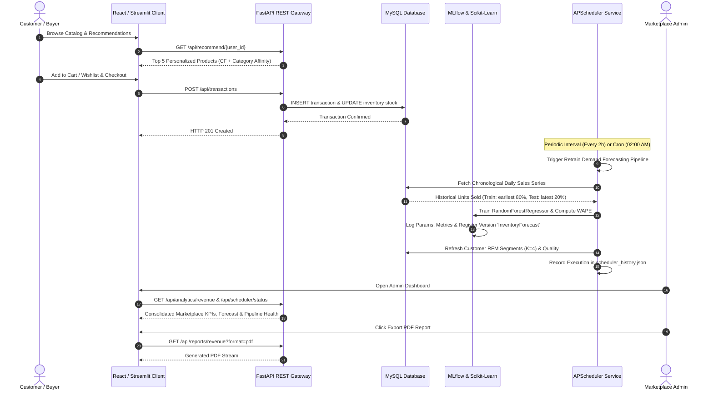

# ShopSense Milestone 3 — Shopping & Analytics Workflow

## 1. End-to-End Workflow Diagram

The workflow encompasses customer purchasing, transactional persistence, scheduled ML pipeline retraining, and automated reporting.

---

## 2. Core Operational Stages

1. **Transactional Stage:**
   - Real-time cart additions, inventory deduction with optimistic locking, and customer orders.
2. **Analytics & Segmentation Stage:**
   - RFM feature extraction (`Recency`, `Frequency`, `Monetary`).
   - K-Means clustering ($K=4$) with normalized silhouettes and 10-seed Adjusted Rand Index stability check.
   - Frequent vs Non-Frequent customer classification based on empirical median order frequency.
3. **Forecasting & ML Lifecycle Stage:**
   - Aggregated daily sales extraction without future leakage (`center=False`, backward lag features).
   - Strict chronological 80/20 train/test holdout evaluation.
   - Automated registration in the MLflow Model Registry.
4. **Automated Pipeline Resilience Stage:**
   - Controlled simulated failure injection tagged `is_test=True`.
   - Production reliability formula excludes test failures while preserving full audit history.
